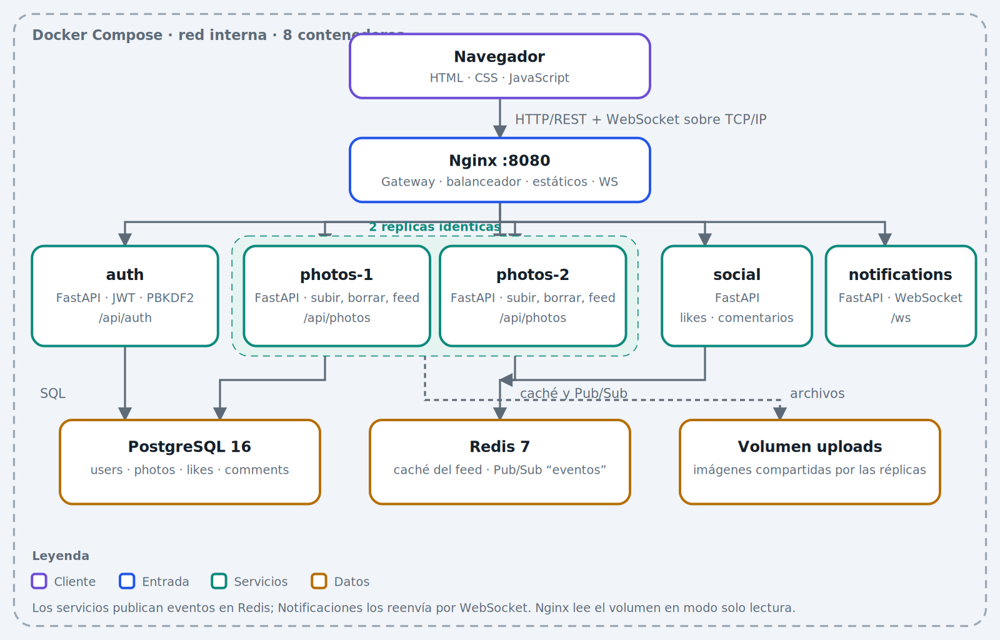

# PhotoShare


<p align="center">
  <a href="https://www.youtube.com/watch?v=REEMPLAZAR_ID" target="_blank" rel="noopener noreferrer">
    
  </a>
</p>


Sistema distribuido para compartir fotos, construido como **microservicios** y orquestado con **Docker Compose**. Demuestra balanceo de carga, tolerancia a fallos, caché, mensajería Pub/Sub, concurrencia y comunicación en tiempo real.



## Características
- Registro e inicio de sesión (JWT).
- Subir fotos con descripción (arrastrar y soltar, vista previa).
- Feed con likes, comentarios y **eliminación de publicaciones propias**.
- Avisos en tiempo real entre usuarios (WebSocket).
- Indicador visible de la réplica que atiende cada petición.

## Tecnologías
| Capa | Tecnología |
|---|---|
| Interfaz | HTML, CSS, JavaScript |
| Gateway / balanceador | Nginx |
| Servicios | Python 3.12, FastAPI, Uvicorn |
| Base de datos | PostgreSQL 16 |
| Caché y mensajería | Redis 7 (caché + Pub/Sub) |
| Autenticación | JWT (HS256), PBKDF2-SHA256 |
| Comunicación | TCP/IP, HTTP/REST, WebSocket |
| Despliegue | Docker, Docker Compose |

## Inicio rápido
Requisitos: Docker y Docker Compose; puerto `8080` libre.

```bash
docker compose up --build
```
Abre **http://localhost:8080**, crea una cuenta y sube una foto. La primera vez tarda 1-2 minutos en construir.

| Comando | Efecto |
|---|---|
| `docker compose up -d` | Inicia en segundo plano |
| `docker compose ps` | Estado de los contenedores |
| `docker compose logs -f photos1 photos2` | Logs de las réplicas |
| `docker compose down` | Apaga y conserva los datos |
| `docker compose down -v` | Apaga y **borra** base de datos y fotos |

## Pruebas rápidas de los conceptos distribuidos
```bash
# Balanceo: el campo served_by alterna entre photos-1 y photos-2
for i in 1 2 3 4; do curl -s localhost:8080/api/photos/feed | grep -o '"served_by":"[^"]*"'; done

# Tolerancia a fallos: el sistema sigue funcionando con una réplica caída
docker compose stop photos1 && curl -s localhost:8080/api/photos/feed | grep -o '"served_by":"[^"]*"'
docker compose start photos1
```
Plan de pruebas completo (caché, Redis caído, tiempo real, concurrencia, autorización): [`docs/06-despliegue-y-pruebas.md`](docs/06-despliegue-y-pruebas.md).

## Estructura del proyecto
```
photoshare/
├── docker-compose.yml     # orquestación de los 8 contenedores
├── nginx/nginx.conf       # gateway, balanceo y proxy WebSocket
├── db/init.sql            # esquema de la base de datos
├── common/                # código compartido (db, Redis, seguridad)
├── auth/ photos/ social/ notifications/   # microservicios
├── frontend/index.html    # interfaz de usuario
└── docs/                  # documentación detallada
```

## Servicios y rutas
| Servicio | Rutas | Función |
|---|---|---|
| auth | `/api/auth/*` | Registro, login, token |
| photos (×2) | `/api/photos` | Feed, subir y eliminar fotos |
| social | `/api/social/*` | Likes y comentarios |
| notifications | `/ws` | Eventos en tiempo real |

Referencia completa en [`docs/04-api.md`](docs/04-api.md).

## Documentación
| Documento | Contenido |
|---|---|
| [`docs/arquitectura.html`](docs/arquitectura.html) | Página visual con arquitectura, tecnologías y flujos |
| [01 Conceptos](docs/01-conceptos.md) | Teoría, aplicaciones reales, ventajas y desventajas |
| [02 Arquitectura](docs/02-arquitectura.md) | Componentes y decisiones de diseño |
| [03 Flujos](docs/03-flujos.md) | Diagramas de secuencia |
| [04 API](docs/04-api.md) | Endpoints y errores |
| [05 Base de datos](docs/05-base-de-datos.md) | Modelo ER, caché y almacenamiento |
| [06 Despliegue y pruebas](docs/06-despliegue-y-pruebas.md) | Ejecución, pruebas, solución de problemas |
| [07 Limitaciones y sustentación](docs/07-limitaciones-y-sustentacion.md) | SPOF, mejoras y preguntas frecuentes |
| [`docs/images/`](docs/images/README.md) | 8 imágenes de arquitectura y flujos (SVG + PNG) y capturas opcionales |

## Decisiones de diseño destacadas
- **Servicios sin estado** y JWT validado localmente: se pueden agregar réplicas sin coordinación.
- **Redis** como caché (TTL 30 s con invalidación) y bus de eventos desacoplado.
- **Degradación elegante:** si Redis cae, el sistema sigue funcionando sin caché ni avisos.
- **Concurrencia en la base de datos:** clave primaria `(user_id, photo_id)` y `ON CONFLICT DO NOTHING`.

## Limitaciones
Base de datos y volumen compartidos (simplificación académica); Nginx, PostgreSQL y el volumen son puntos únicos de falla; sin HTTPS ni pruebas automatizadas. Detalle y mejoras en [`docs/07-limitaciones-y-sustentacion.md`](docs/07-limitaciones-y-sustentacion.md).
