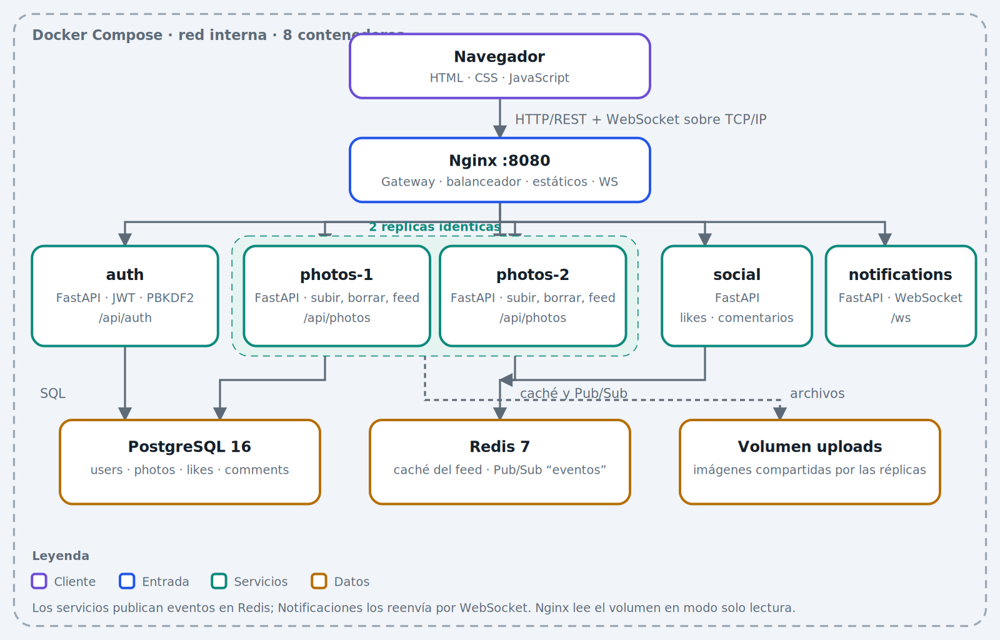
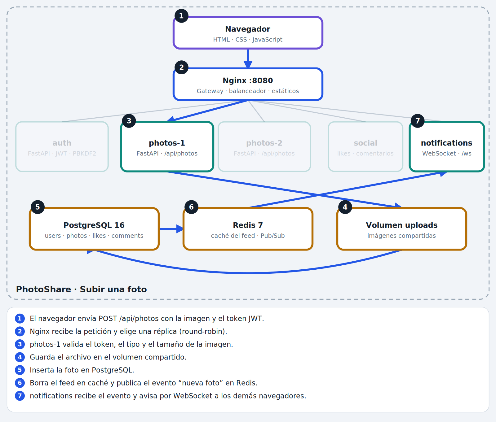
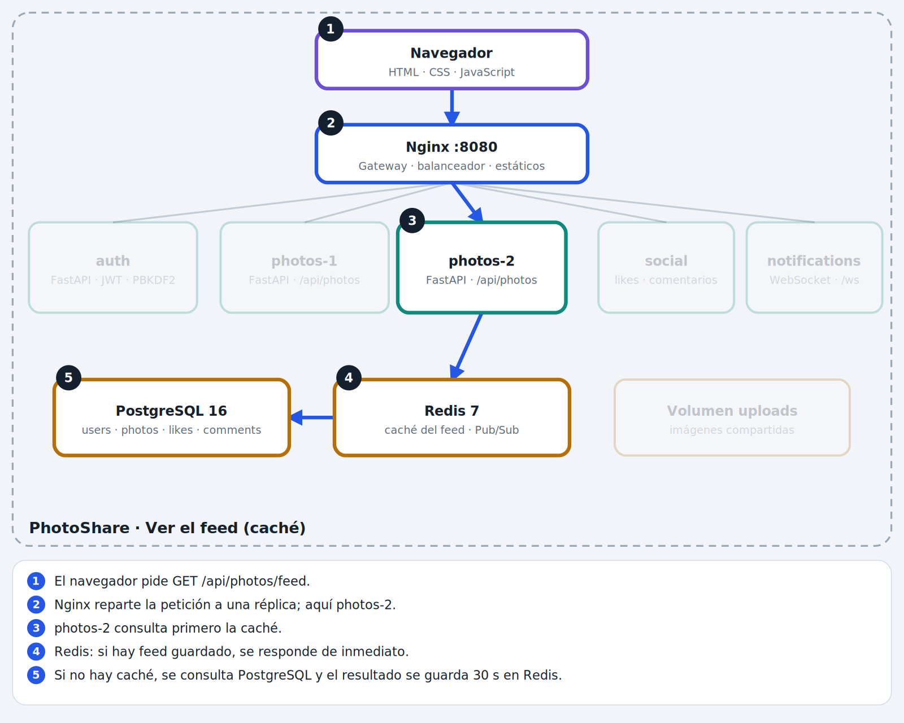
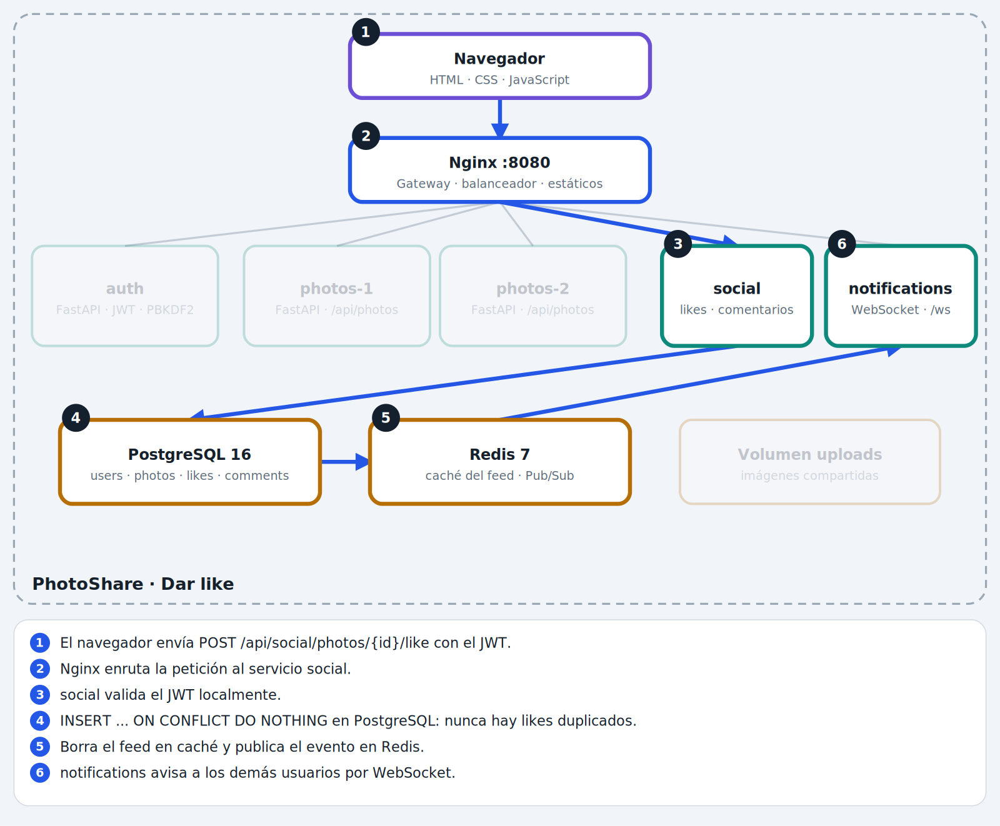
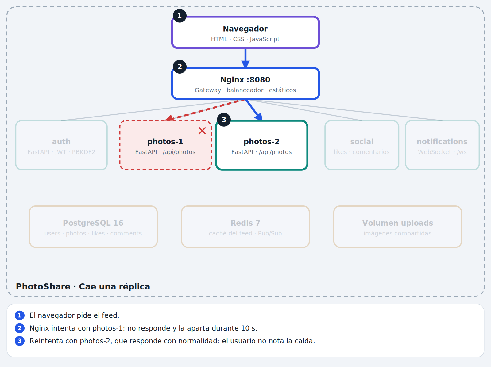

# 2. Arquitectura

PhotoShare está formado por **microservicios** que se comunican por red y se despliegan como **8 contenedores** con Docker Compose. Solo Nginx es visible desde el exterior (puerto `8080`).



## 2.1 Vista por capas

| Capa | Componente | Tecnología | Responsabilidad |
|---|---|---|---|
| Cliente | Navegador | HTML, CSS, JavaScript | Interfaz de usuario, `fetch` y WebSocket |
| Entrada | Nginx | Nginx (alpine) | Gateway, balanceador, estáticos y proxy WebSocket |
| Servicios | `auth` | Python 3.12, FastAPI, PyJWT | Registro, login y tokens |
| Servicios | `photos1`, `photos2` | Python 3.12, FastAPI | Subir y eliminar fotos, feed |
| Servicios | `social` | Python 3.12, FastAPI | Likes y comentarios |
| Servicios | `notifications` | FastAPI, WebSocket, redis.asyncio | Avisos en tiempo real |
| Datos | PostgreSQL 16 | SQL | Datos persistentes (fuente de verdad) |
| Datos | Redis 7 | Clave-valor, Pub/Sub | Caché del feed y bus de eventos |
| Datos | Volumen `uploads` | Docker volume | Imágenes compartidas entre réplicas |
| Infraestructura | Docker Compose | Docker | Orquestación de los 8 contenedores |

## 2.2 Comunicación entre componentes

| Origen | Destino | Protocolo | Para qué |
|---|---|---|---|
| Navegador | Nginx | HTTP/REST sobre TCP/IP | Todas las acciones del usuario |
| Navegador | Nginx → notifications | WebSocket | Avisos en vivo |
| Nginx | auth, photos, social | HTTP interno | Enrutamiento y balanceo |
| Servicios | PostgreSQL | SQL (psycopg2) | Leer y escribir datos |
| Servicios | Redis | Comandos Redis | Caché del feed |
| photos, social | Redis → notifications | Pub/Sub (canal `eventos`) | Eventos entre servicios |
| photos | Volumen | Sistema de archivos | Guardar y borrar imágenes |
| Nginx | Volumen | Solo lectura | Servir imágenes en `/uploads/` |

Dentro de la red de Compose los servicios se encuentran **por nombre** (`db`, `redis`, `auth`...), no por `localhost`.

## 2.3 Flujos principales

### Subir una foto


### Ver el feed (con caché)


### Dar like


### Caída de una réplica


Los demás flujos (registro, eliminar y tiempo real) están en [`images/`](images/) y los diagramas de secuencia en [03-flujos.md](03-flujos.md).

## 2.4 Decisiones de diseño

1. **Un solo punto de entrada (API Gateway).** Solo Nginx publica un puerto; los servicios no son accesibles desde fuera. Simplifica la seguridad y da transparencia al usuario.
2. **Servicios sin estado.** Ningún servicio guarda sesión en memoria; el estado vive en PostgreSQL, Redis y el volumen. Por eso se pueden agregar réplicas sin coordinación.
3. **Autenticación con JWT.** Auth firma el token (HS256, 24 h) y los demás servicios lo validan localmente con el secreto compartido, sin llamar a Auth en cada petición.
4. **Redis con dos funciones.** Caché del feed (clave `feed`, TTL 30 s, invalidada al subir, borrar, dar like o comentar) y bus Pub/Sub (canal `eventos`).
5. **Desacoplamiento por eventos.** Fotos y Social no conocen a Notificaciones: solo publican en Redis. Se pueden añadir otros consumidores sin modificarlos.
6. **Degradación elegante.** Las operaciones con Redis están protegidas con `try/except`: si Redis cae se pierden la caché y los avisos, pero el sistema sigue respondiendo.
7. **Contraseñas con PBKDF2-SHA256** (100 000 iteraciones y sal aleatoria), usando solo la librería estándar de Python.
8. **Base de datos compartida (simplificación).** Por claridad académica los servicios comparten PostgreSQL; en producción cada servicio tendría la suya.

## 2.5 Configuración relevante de Nginx

- `upstream photos_svc` con `max_fails=1 fail_timeout=10s`: una réplica que falla se aparta 10 s.
- `proxy_next_upstream error timeout http_502 http_503`: reintenta con la otra réplica.
- `client_max_body_size 8m`: permite subir imágenes de hasta 5 MB más el sobrecoste multipart.
- Cabeceras `Upgrade` y `Connection` para mantener los WebSockets.
- `/uploads/` se sirve directamente desde el volumen, sin pasar por Python.

## 2.6 Estructura del repositorio

```
photoshare/
├── docker-compose.yml      # orquestación
├── nginx/nginx.conf        # gateway y balanceo
├── db/init.sql             # esquema de la base de datos
├── common/                 # código compartido: db, events (Redis), security (JWT)
├── auth/ photos/ social/ notifications/   # un directorio por servicio
├── frontend/index.html     # interfaz de usuario
└── docs/                   # documentación
```