# 3. Flujos del sistema

Versión en imagen (para Word/PDF): [`images/`](images/) contiene un `flujo-*.png` por cada flujo.

| Flujo | Imagen |
|---|---|
| Registro | 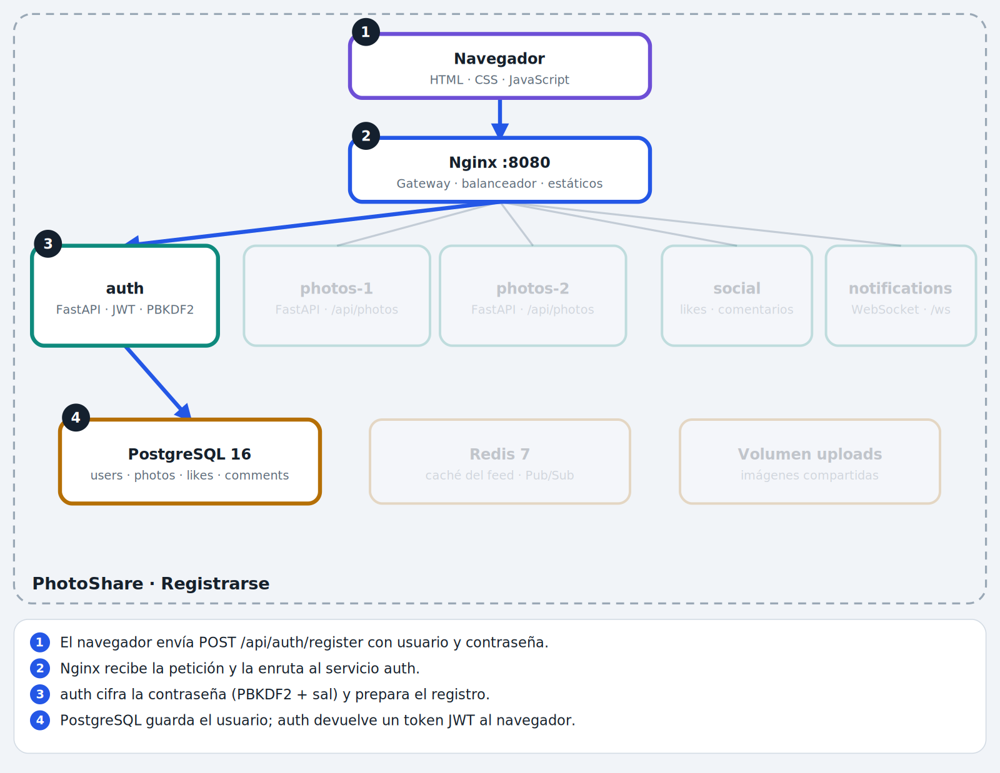 |
| Subir foto | 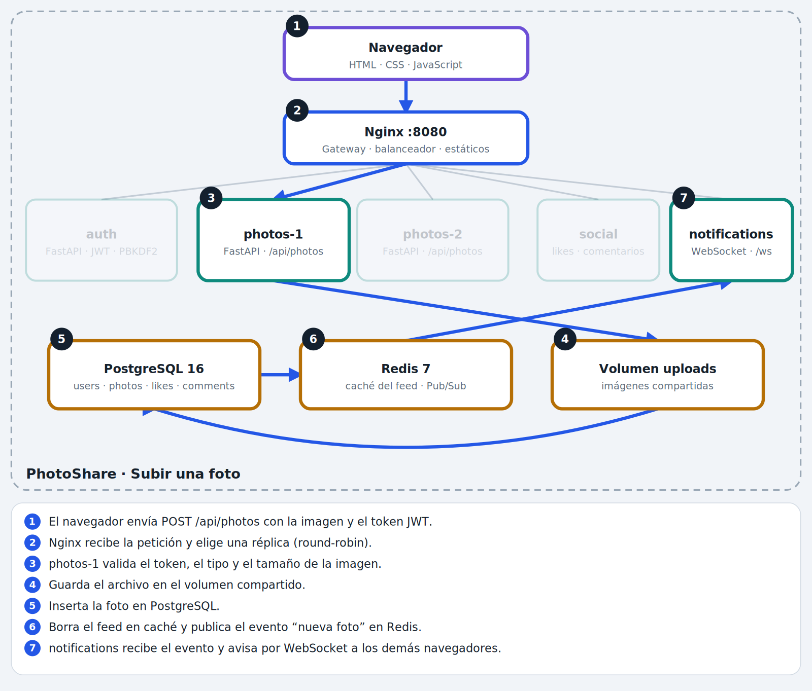 |
| Feed | 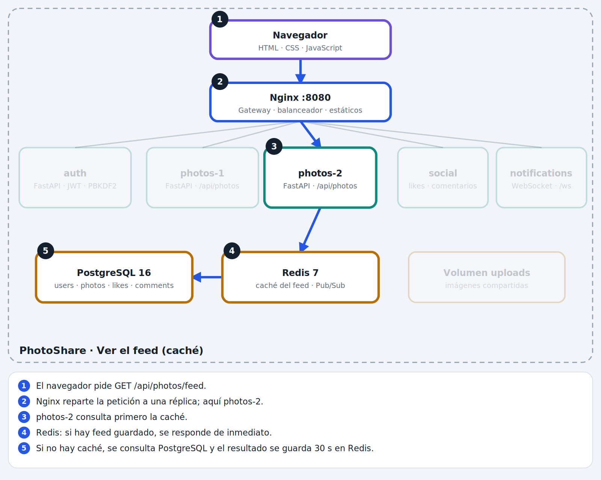 |
| Like | 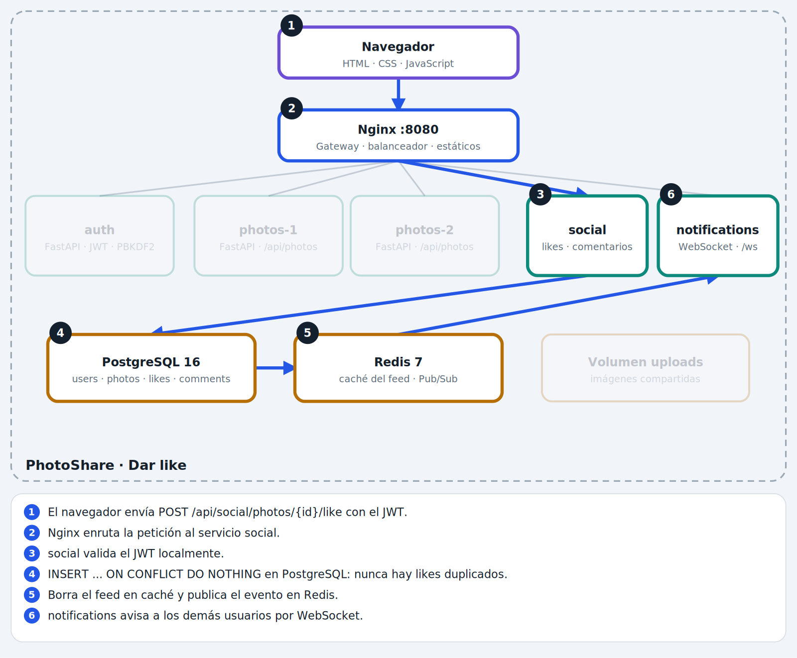 |
| Eliminar | 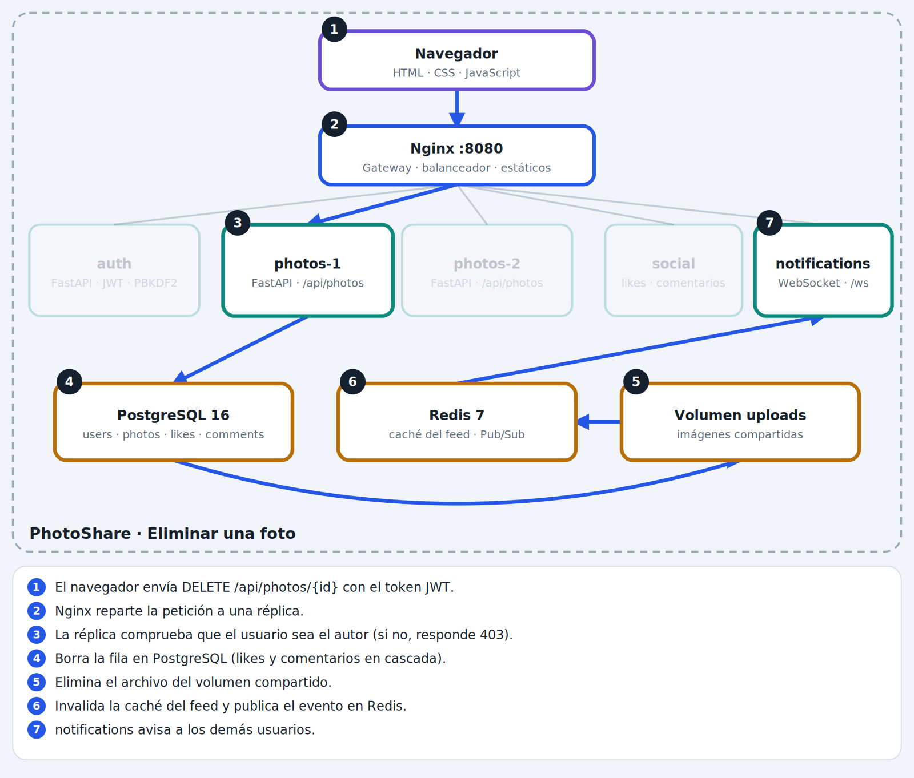 |
| Tiempo real | 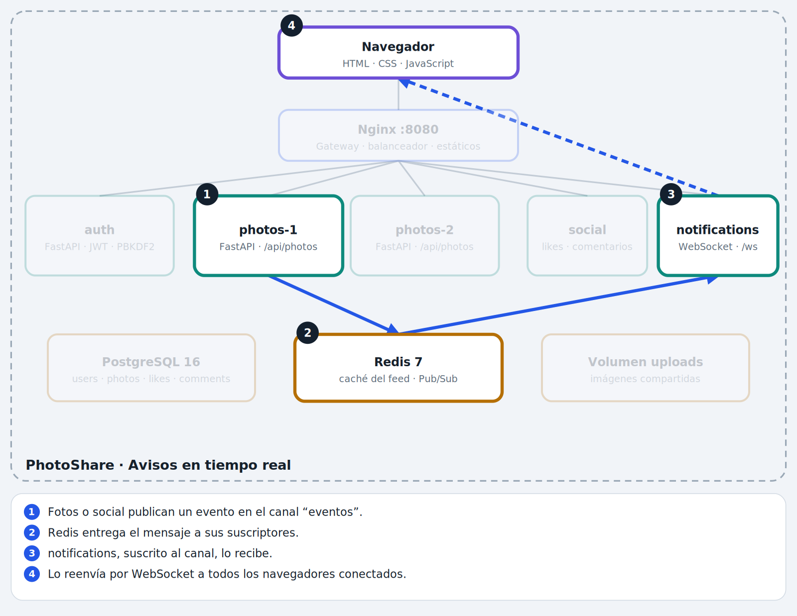 |
| Caída de réplica | 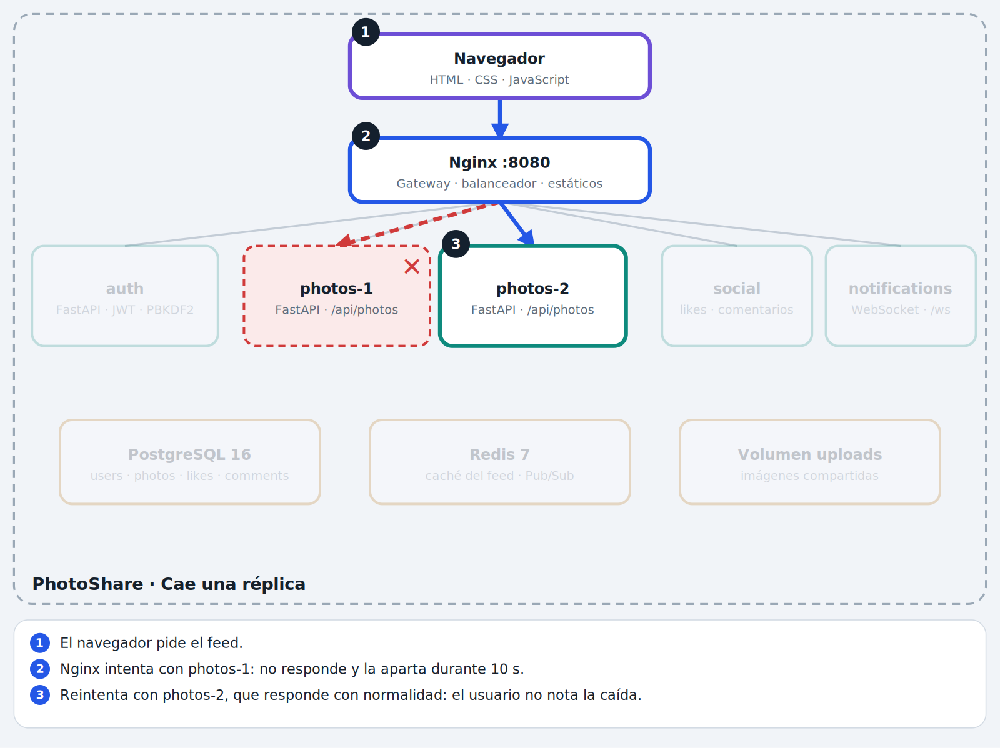 |

Los diagramas se renderizan automáticamente en GitHub, GitLab y VS Code (extensión Markdown Mermaid).

## 3.1 Registro e inicio de sesión
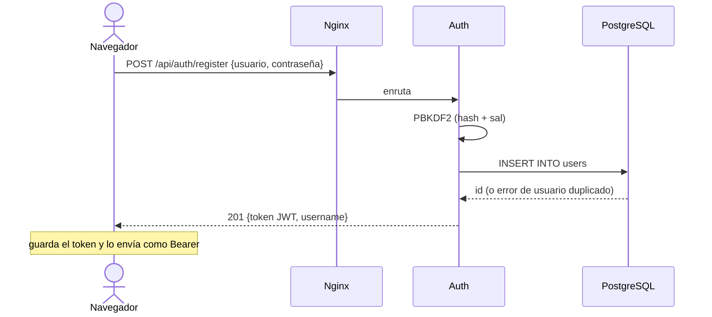

## 3.2 Subir una foto
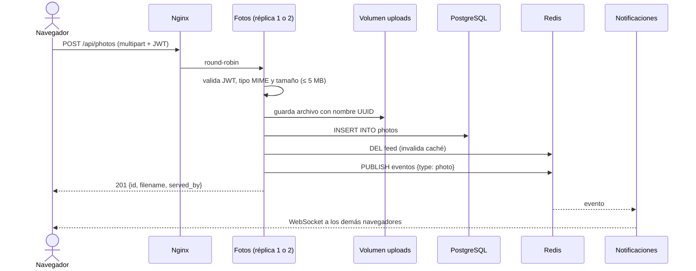

## 3.3 Ver el feed (con caché)
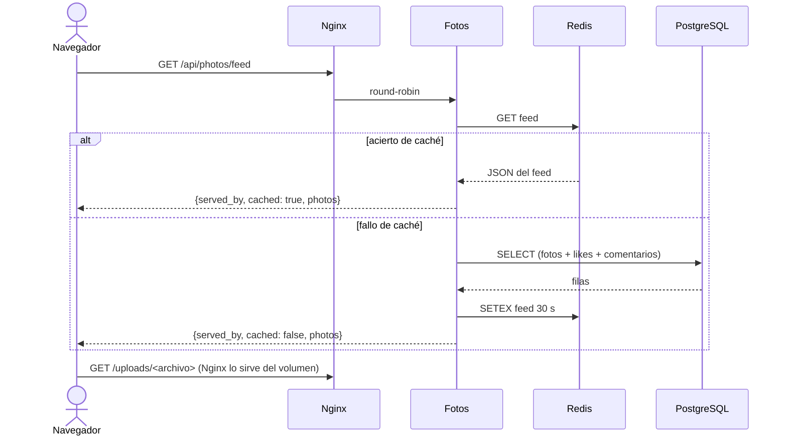

## 3.4 Dar like (concurrencia)
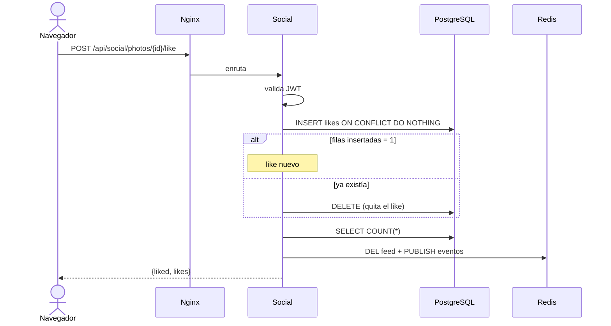

## 3.5 Eliminar una foto
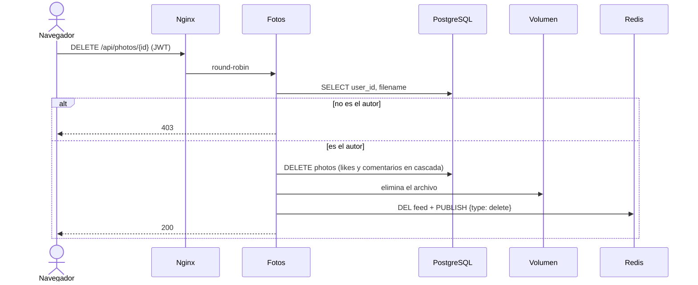

## 3.6 Avisos en tiempo real
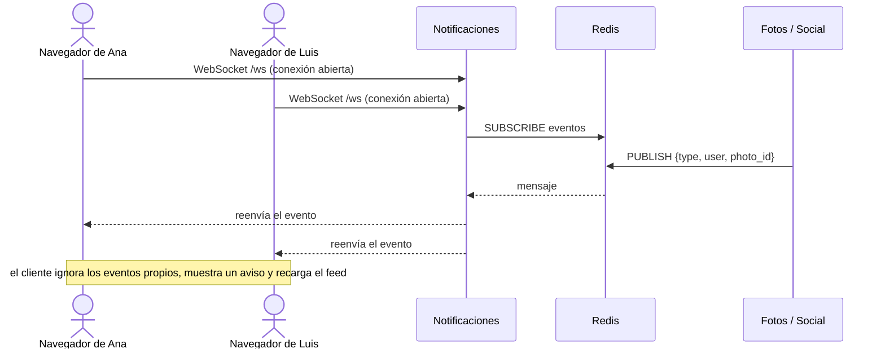

## 3.7 Caída de una réplica
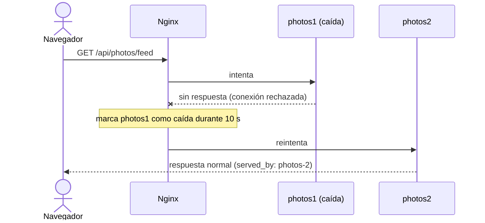
