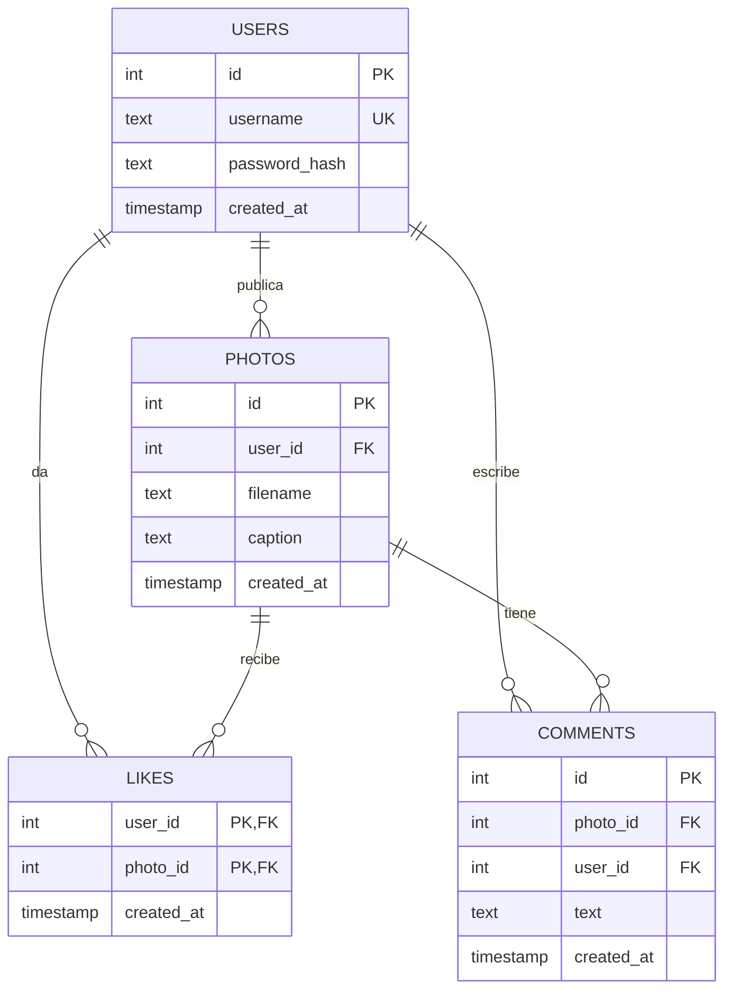

# 5. Base de datos, caché y almacenamiento

## Modelo entidad-relación (PostgreSQL)


## Tablas
| Tabla | Propósito | Detalles |
|---|---|---|
| `users` | Cuentas | `username` único; `password_hash` = `sal$hash` PBKDF2 |
| `photos` | Metadatos de las imágenes | `filename` apunta al archivo en el volumen |
| `likes` | Me gusta | PK compuesta `(user_id, photo_id)`: un like por usuario y foto |
| `comments` | Comentarios | Índice por `photo_id` |

- `ON DELETE CASCADE` en `likes` y `comments`: al borrar una foto desaparecen sus likes y comentarios.
- Índices: `idx_photos_created` (feed ordenado) e `idx_comments_photo`.
- El esquema está en `db/init.sql` y se ejecuta **solo en el primer arranque** (cuando el volumen `pgdata` está vacío).

## Redis
| Uso | Detalle |
|---|---|
| Caché del feed | Clave `feed`, valor JSON, TTL 30 s. Se elimina al subir/borrar foto, dar like o comentar |
| Pub/Sub | Canal `eventos`. Publican `photos` y `social`; consume `notifications` |

Redis **no es fuente de verdad**: si se pierde, el sistema se reconstruye desde PostgreSQL.

## Almacenamiento de archivos
- Volumen Docker `uploads`, montado en `/data/uploads` en las réplicas de Fotos (lectura/escritura) y en Nginx (solo lectura).
- Los archivos se guardan con nombre UUID para evitar colisiones y no exponer nombres originales.

## Persistencia
| Volumen | Contiene | Se borra con |
|---|---|---|
| `pgdata` | Base de datos | `docker compose down -v` |
| `uploads` | Imágenes | `docker compose down -v` |

## Consultas útiles
```bash
docker compose exec db psql -U app -d photoshare -c "SELECT id, username FROM users;"
docker compose exec db psql -U app -d photoshare -c "SELECT photo_id, COUNT(*) FROM likes GROUP BY photo_id;"
docker compose exec redis redis-cli TTL feed
docker compose exec redis redis-cli SUBSCRIBE eventos
```
